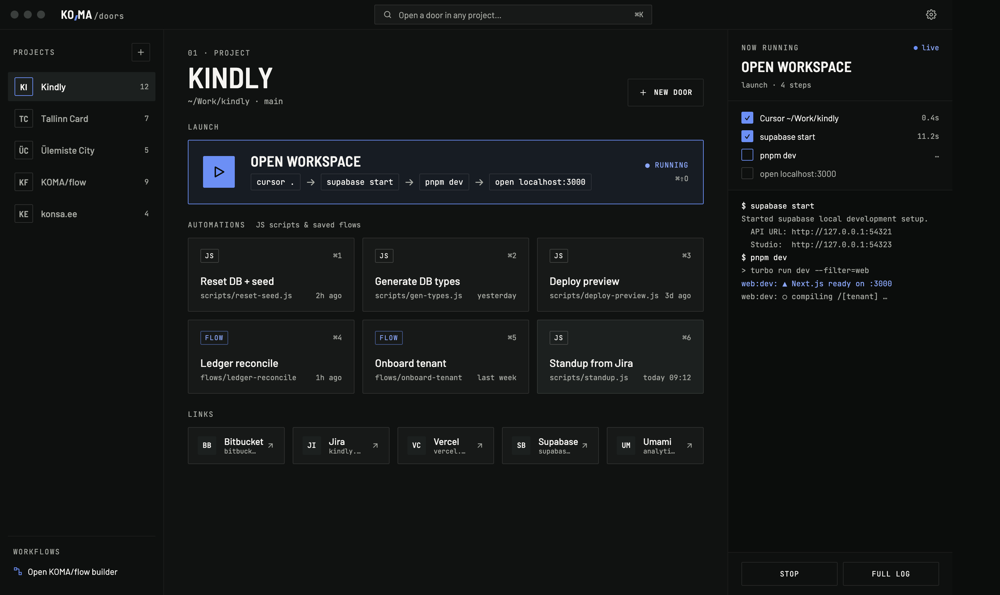
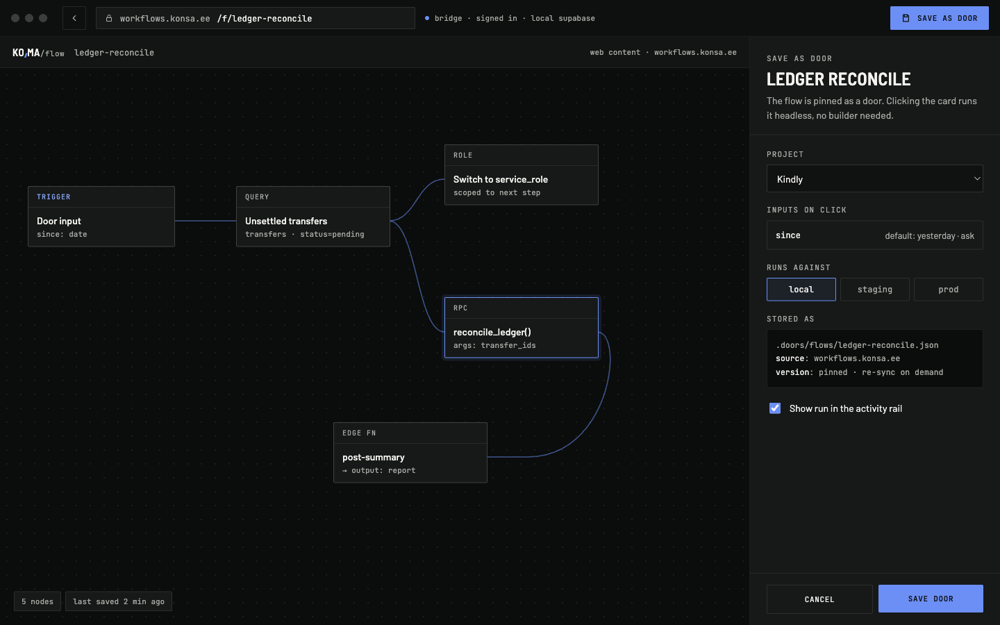

# KO,MA

Project: Doors

---

## Simple &  local  desktop workflow helper

---

A Tauri 2 desktop app for projects and their **doors**: one-click ways into a project

 

;


| Door           | What a click does                                                                                                                      |
| -------------- | -------------------------------------------------------------------------------------------------------------------------------------- |
| Project opener | Runs steps in order: open the folder in Cursor, `supabase start`, `pnpm dev` (kept running, waits for its port), open `localhost:3000` |
| JS script      | Runs a `.mjs`/`.js` file with `node` in the project folder; edit it in the built-in editor                                             |
| Flow           | Opens a KOMA/flow workflow (workflows.konsa.ee) inside the app                                                                         |
| Link           | Opens a URL in the browser or a local folder/file                                                                                      |
| Note           | Plain text kept with the project                                                                                                       |


Output of openers and scripts streams into the run panel on the right; Stop ends the process and everything it started. Background processes are stopped when the app quits.

## Run

Needs Node, pnpm and Rust (`curl https://sh.rustup.rs -sSf | sh`).

```sh
pnpm install
pnpm app          # tauri dev: desktop window with hot reload
pnpm app:build    # release build: .app / .dmg in src-tauri/target/release/bundle
pnpm dev          # UI only, in a browser at http://localhost:1420 (links work; scripts and local paths don't)
```


## Keyboard

`⌘K` open any door · `⌘N` new door · `⌘1–9` run the current project's automations · `Esc` close / back · in the script editor `⌘S` save, `⌘↵` save & run.

## Where things live

- **Design tokens** (colors, fonts, radii from konsa.ee): `src/input.css` → Tailwind utilities like `bg-bg-soft`, `text-ink-dim`, `border-line`, `bg-brand`, `font-display`, `font-mono`; component classes `.btn`, `.field`, `.tag`, `.eyebrow`, `.door`.
- **Projects and doors** are saved in one JSON file, `~/Library/Application Support/ee.konsa.home/doors.json` (shared by dev and release builds). Settings → *Where your data lives* can move it to another folder, e.g. iCloud Drive or a git repo; that choice is kept in `settings.json` next to it. On first launch the file is created from earlier localStorage data or `src/doors/seeds.ts`.
- **New scripts** are written to the app data folder, `scripts/<project>/<name>.mjs` (or point a door at any existing file).
- **Process runner** (spawn through your login shell, stream output, stop, wait for a port, read/write script files): `src-tauri/src/runner.rs`; the TypeScript side is `src/lib/native.ts` and `src/doors/runs.ts`.
- **Apps for “open in app” steps:** `src/apps.ts`. **Script templates:** `src/doors/templates.ts`.
- **App icon:** replace `app-icon.png` (1024×1024) and run `pnpm tauri icon app-icon.png`.

Scripts and shell steps run with your user's full permissions — only add commands you'd run in your own terminal.